# Soportes del despliegue en AWS (Entrega 3)

Despliegue de la API y del tablero en contenedores Docker sobre una máquina virtual AWS EC2,
realizado el 23 de noviembre de 2026 a partir de `main` (commit `e7a19e3`, PR #10).
Responsable: Libardo Navas Quiroga.

## Recursos empleados

| Recurso | Valor |
|---|---|
| Servicio | AWS EC2 (AWS Academy Learner Lab), región us-east-1 (zona us-east-1d) |
| Instancia | `proyecto-g39` (`i-0d511f334ae68a92d`), tipo `t3.small` (2 vCPU, 2 GiB) |
| Sistema operativo | Ubuntu Server 24.04 LTS |
| Almacenamiento | 20 GiB (EBS) |
| Grupo de seguridad | `sg-05a4d20d38569ee58` (`launch-wizard-11`): entrada TCP 22 (SSH), 8001 (API) y 8050 (tablero) desde `0.0.0.0/0` |
| IP pública durante el despliegue | `3.80.214.149` (cambia si se reinicia el laboratorio) |
| Software | Docker 29.10.0 y Docker Compose v5.8.0 |
| Imágenes | `precios-api` (696 MB) y `precios-tablero` (563 MB) |
| Contenedores | `api` (uvicorn, puerto 8001) y `tablero` (gunicorn, puerto 8050), en la red de compose `proyecto-precios-inmobiliarios_default` |

Direcciones del despliegue:
- Tablero: `http://3.80.214.149:8050`
- API (Swagger): `http://3.80.214.149:8001/docs`
- Estado de la API: `http://3.80.214.149:8001/api/v1/health`

## Procedimiento
1. Crear la instancia EC2 con el grupo de seguridad (puertos 22, 8001 y 8050).
2. Conectarse por SSH e instalar Docker y el plugin de compose desde el repositorio oficial de Docker.
3. Clonar el repositorio (`git clone ...proyecto-precios-inmobiliarios.git`). El modelo entrenado ya está en `models/`.
4. Construir y levantar los dos contenedores: `sudo docker compose up --build -d`.
5. Verificar la API (Swagger y `/health`), el tablero en el navegador y los registros de los contenedores.

Los comandos completos están en el manual de instalación del tablero.

## Soportes

### 1. Configuración de la instancia
Ubuntu 24.04, `t3.small`, grupo de seguridad nuevo y 20 GiB de disco.

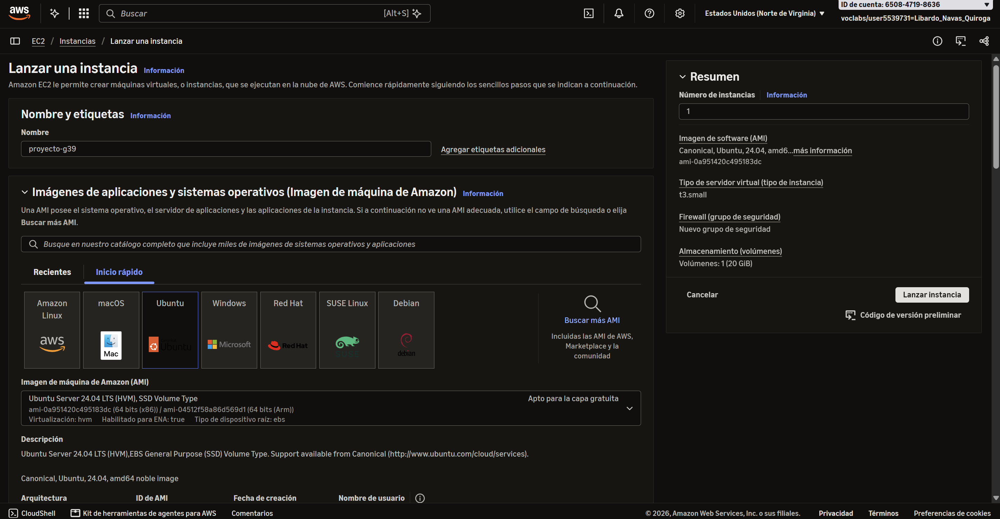

### 2. Instancia en ejecución
Estado *En ejecución*, IP pública `3.80.214.149` e IP privada `172.31.20.66`.

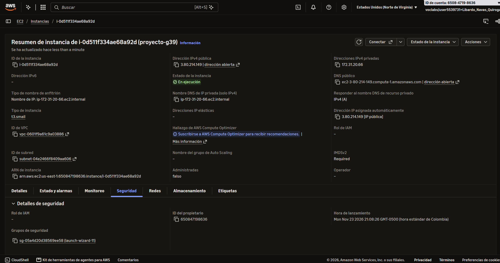

### 3. Conexión por SSH
Sesión abierta en la instancia (`ubuntu@ip-172-31-20-66`).

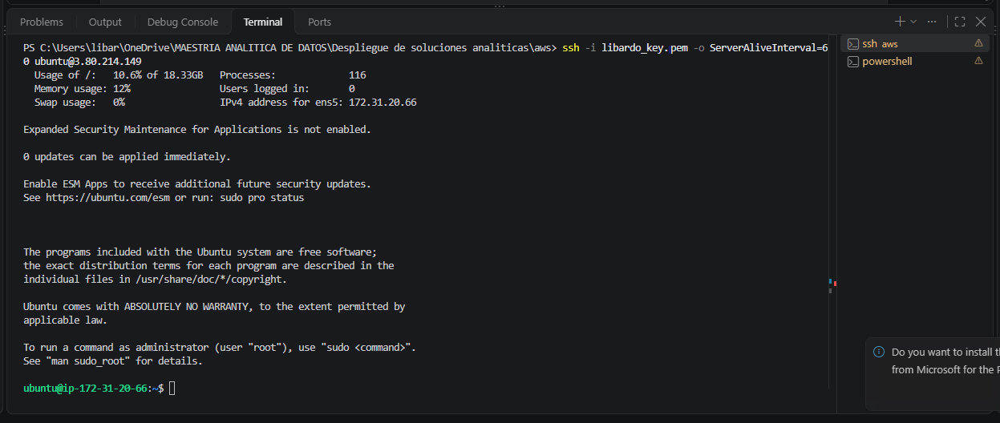

### 4. Docker instalado
Docker 29.10.0 y Docker Compose v5.8.0.

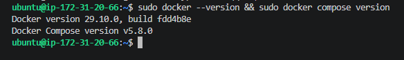

### 5. Código del proyecto en la instancia
Repositorio clonado en la versión `e7a19e3` (PR #10), con las carpetas `api/`, `dashboard/`, `models/` y `docker-compose.yml`.

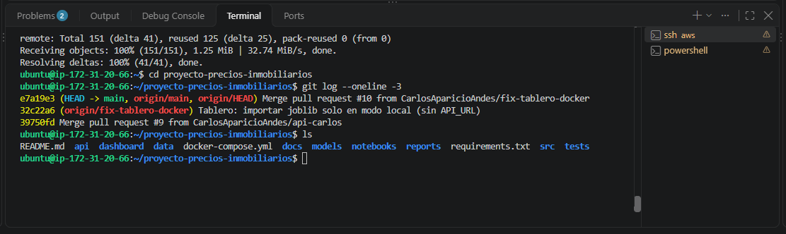

### 6. Imágenes y contenedores en ejecución
`docker compose up --build -d` construyó `precios-api` y `precios-tablero`. La API quedó *healthy* en el
puerto 8001 y el tablero *Up* en el 8050.

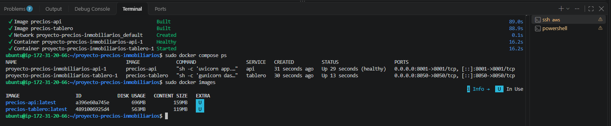

### 7. API: predicción desde Swagger
`POST /api/v1/predict` responde 200 con el precio (305.682) y la versión del modelo (`v2`, tendencia + boosting).

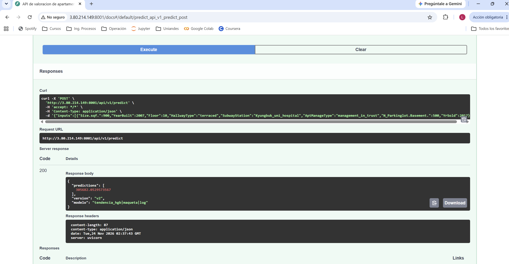

### 8. API: estado del servicio
`GET /api/v1/health` devuelve `estado: ok`, la versión de la API (0.2.0) y la del modelo (v2).

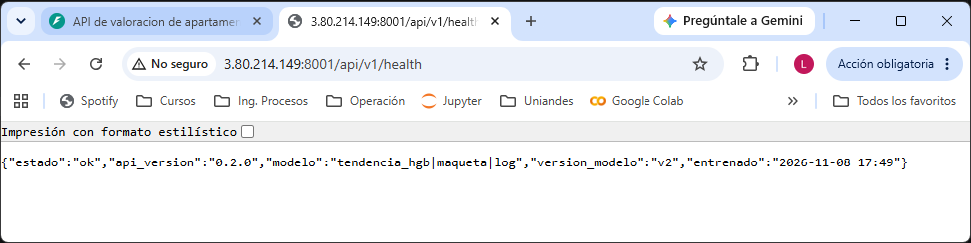

### 9. Tablero desplegado
**9a. Valores por defecto:** precio de 240.339, con intervalo del 80 % de 221.020 a 259.107, 26 % por debajo
de la mediana de Banwoldang.

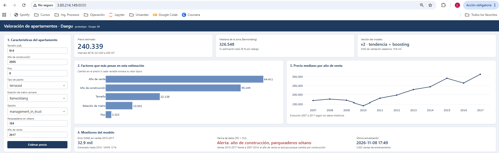

**9b. Valores modificados** (1.500 sqf, construido en 2013, piso 20, Kyungbuk_uni_hospital, 800 parqueaderos):
precio de 505.863, 104 % por encima de la mediana de su zona; el tamaño y el piso pasan a estar entre los factores
que más pesan.

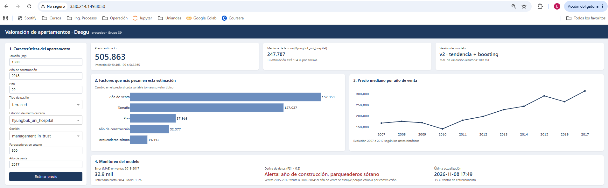

### 10. Integración tablero → API
**10a.** Registros de la API: cada estimación del tablero llega como `POST /api/v1/predict` con `200 OK`
desde la IP `172.18.0.3`.

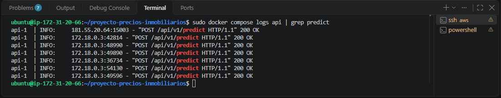

**10b.** IP de los contenedores en la red de compose: `172.18.0.3` es el tablero y `172.18.0.2` la API.
Las predicciones viajan del contenedor del tablero al de la API por la red interna (`API_URL=http://api:8001/api/v1/predict`).

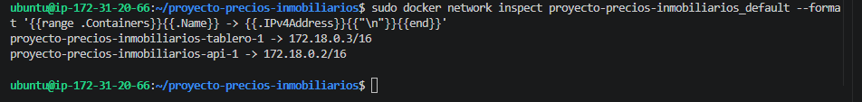

### 11. Reglas de entrada del grupo de seguridad
Puertos 22, 8001 y 8050 abiertos (TCP, origen `0.0.0.0/0`).

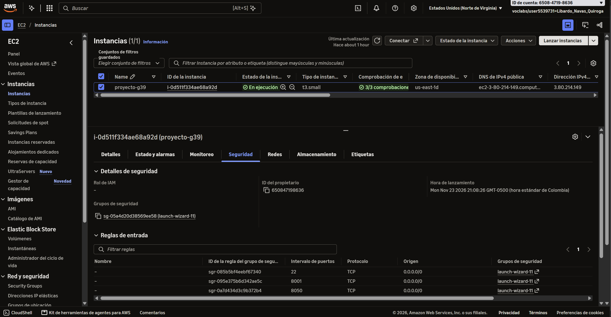

## Observaciones
- El primer intento del tablero en contenedor fallaba por un `import joblib` que la imagen no instalaba;
  se corrigió en el PR #10 antes de este despliegue.
- Los campos numéricos del tablero solo aceptan valores dentro del rango de los datos (por ejemplo, año de
  construcción entre 1978 y 2015). Fuera de ese rango, el tablero pide completar los campos.
- En AWS Academy la IP pública cambia al reiniciar el laboratorio. Para volver a levantar la solución basta con
  `cd proyecto-precios-inmobiliarios && sudo docker compose up -d`.
